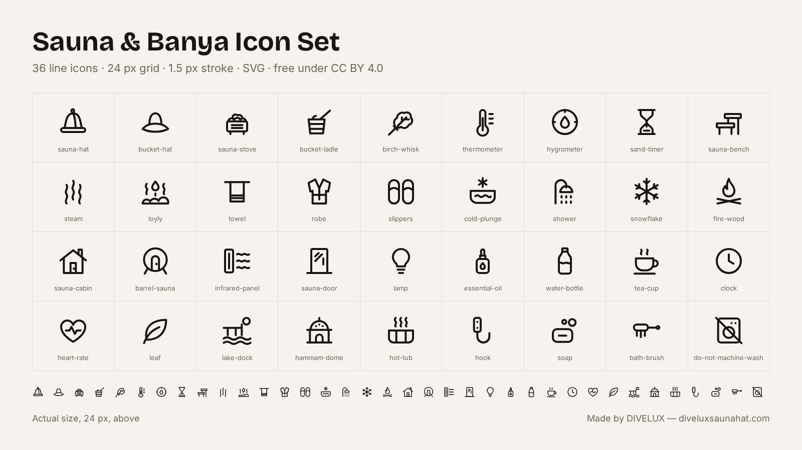

# Sauna & Banya Icon Set

36 free line icons for sauna, banya, steam room and cold plunge projects: apps, websites, signage, spa menus, printables.

Made by DIVELUX, makers of handmade wool sauna hats — https://diveluxsaunahat.com



## What is inside

| Path | What it is |
|---|---|
| `svg/` | 36 separate SVG files |
| `sprite.svg` | all icons as `<symbol>` elements in one file |
| `icons.json` | names, titles and search tags for every icon |
| `preview.png`, `preview-dark.png` | contact sheets on a light and a dark background |
| `src/build.py` | the source: path data for every icon, builds everything above |
| `LICENSE` | CC BY 4.0 |

## Style

- 24 x 24 px grid, 1.5 px stroke, round caps and round joins
- No fills. Every icon is drawn with strokes only and uses `currentColor`, so it takes the text color of its parent
- Plain hand-written SVG: only `path`, `rect` and `circle`, no transforms, no styles, no IDs

## Icons

sauna-hat, bucket-hat, sauna-stove, bucket-ladle, birch-whisk, thermometer, hygrometer, sand-timer, sauna-bench, steam, loyly, towel, robe, slippers, cold-plunge, shower, snowflake, fire-wood, sauna-cabin, barrel-sauna, infrared-panel, sauna-door, lamp, essential-oil, water-bottle, tea-cup, clock, heart-rate, leaf, lake-dock, hammam-dome, hot-tub, hook, soap, bath-brush, do-not-machine-wash

## How to use

Inline, so the icon follows your text color:

```html
<span style="color:#1b1512">
  <svg width="24" height="24"><use href="sprite.svg#sauna-hat"/></svg>
</span>
```

As an image:

```html

```

Change the size with `width` and `height`. To change the line weight, set `stroke-width` on the `<svg>` element (1.5 is the default; 1.25 to 2 looks good).

In Figma, drag the SVG files onto the canvas. Strokes stay editable.

## Rebuild

```
python3 src/build.py
```

Edit the path data in `src/build.py`, then run the script to regenerate `svg/`, `sprite.svg` and `icons.json`.

## License and credit

Free for personal and commercial use under [CC BY 4.0](https://creativecommons.org/licenses/by/4.0/). Please credit:

> Icons by DIVELUX — diveluxsaunahat.com

More free sauna tools: https://diveluxsaunahat.com/pages/sauna-tools
